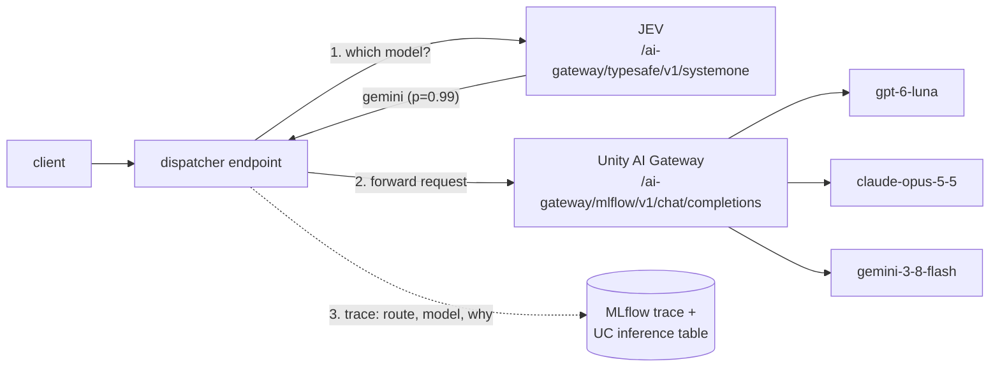

# Simple Model Dispatcher

## Per-request model routing on Unity AI Gateway

Clients send every request to **one** endpoint. A small judge model (**JEV**)
reads each request and picks the model that fits it, and the dispatcher
forwards the request through Unity AI Gateway:

| Route | Model (`system.ai.*`) | Picked for |
| --- | --- | --- |
| **luna** (default) | `gpt-6-luna` | Everyday and low-difficulty work, including work over a lot of context: chat, summaries, extraction, classification, long docs and logs. Cheap and fast. |
| **opus** | `claude-opus-5-5` | Work that needs deep intelligence: hard reasoning, proofs, complex code, architecture trade-offs, subtle debugging. |
| **gemini** | `gemini-3-8-flash` | Visual and creative craft: UI/visual design, layouts, real-world 3D/spatial reasoning, polished written copy. Set `GEMINI_MODEL=system.ai.gemini-4-argon` where argon is rolled out. |

The router is `system.ai.openjev-qwen35-4b` (OpenJev). It answers a single
`choice` question with a probability for each route and generates no text, so
a routing call is cheap, fast, and auditable.

**Why OpenJev and not Jev?** TypeSafe AI's Jev
(`system.ai.typesafeai-jev-1-14-0`) speaks the same System One API and looks
like the stronger router. It is listed in `system.ai` but not yet served in
production workspaces (`ENDPOINT_NOT_FOUND` on fe-vm and e2-demo; it answers
on dogfood). Both score 12/12 on `eval_routing.py`. Switch with
`JEV_MODEL=system.ai.typesafeai-jev-1-14-0` (or `--var jev_model=...`) once
it's served in your workspace.

**Every model call runs as the caller.** The endpoint calls the gateway
on-behalf-of the user who queried it, so the caller's own `EXECUTE` grants
apply, and `system.ai_gateway.usage` bills each request to that person. There
are no secrets and no shared service principal (see
[Identity](#identity-on-behalf-of-user-no-secrets)).



The whole dispatcher is one function in `agent.py`:

```python
@mlflow.trace(name="dispatch", span_type=SpanType.AGENT)
def dispatch(messages, cfg, client=None, forced_route=None, params=None):
    decision = route_request(client, messages, cfg, forced_route)   # ask JEV
    response = call_model(client, decision.model, decision.route, messages, params)
    _tag_trace(decision)                                            # log why
    return {"text": ..., "routing": decision.as_dict(), "response": response}
```

To change routing behavior, edit the plain-English criteria in `ROUTES`. JEV
judges each request against those sentences.

## How a routing decision is logged

Every request leaves the same evidence in several places, so "which model
ran, and why" is never a guess:

| Where | What you see |
| --- | --- |
| **MLflow trace tags** (searchable) | `dispatcher.route`, `dispatcher.model`, `dispatcher.decided_by`, `dispatcher.jev_confidence`, `dispatcher.reason`, plus `dispatcher.fallback_from` / `dispatcher.fallback_reason` when a fallback ran |
| **MLflow spans** | `dispatch` (AGENT) → `jev_router` (CHAIN; attributes `routing.*` hold JEV's full probability table) → `call_model` (CHAT_MODEL; `model`, `route`, token `usage`). A failed model call is its own red span. |
| **Response** | `custom_outputs.routing` carries the same decision object back to the caller |
| **Inference table** (deployed endpoint, UC) | the endpoint's AI Gateway payload table stores each request's `requester` and the full response, `custom_outputs.routing` included |
| **`system.ai_gateway.usage`** | every gateway call carries `Databricks-Ai-Gateway-Request-Tags: {"app": "simple_dispatcher_agent", "route": "opus"}`, so billing rows show the route too |

Example `custom_outputs.routing` from a live call:

```json
{
  "route": "opus",
  "model": "system.ai.claude-opus-5-5",
  "decided_by": "jev",
  "jev_choice": "opus",
  "confidence": 0.84,
  "probabilities": {"luna": 0.094, "opus": 0.894, "gemini": 0.011},
  "reason": "JEV chose 'opus' with confidence 0.84: Work that needs deep intelligence: ...",
  "fallback_from": null,
  "fallback_reason": null
}
```

`decided_by` is one of these values:

| Value | Meaning |
| --- | --- |
| `jev` | JEV's pick was confident (≥ `ROUTER_MIN_CONFIDENCE`, default 0.5), or JEV picked luna anyway |
| `low_confidence_default` | JEV was unsure, so luna answered. JEV's lean is still recorded in `jev_choice`. |
| `jev_error_default` | The router call failed. Luna answered rather than failing the request. |
| `caller` | The client pinned a route with `custom_inputs: {"route": "opus"}` |

If the chosen model call fails (for example, a model not yet rolled out to the
workspace's region), the dispatcher retries once on luna and records the
fallback. It never silently swaps the model.

Find every request that went to opus, in the MLflow UI search box or with code:

```python
mlflow.search_traces(filter_string="tags.`dispatcher.route` = 'opus'")
```

The deployed endpoint's UC record is its inference table. This query ran
against the dev deploy:

```sql
SELECT request_time,
       requester,
       get_json_object(response, '$.custom_outputs.routing.route')  AS route,
       get_json_object(response, '$.custom_outputs.routing.reason') AS reason
FROM   <catalog>.<schema>.simple_dispatcher_agent_payload
ORDER  BY request_time DESC;
```

Where the traces live:
- **Local runs and the deploy job:** the target experiment, UC-backed when
  `BASE_CATALOG`/`BASE_SCHEMA` are set.
- **The deployed endpoint:** a workspace-managed sibling experiment,
  `<experiment>_endpoint`. Serving writes traces as a hidden system principal
  that gets a new id on every deploy and has no UC grants, so it can't write a
  UC-linked experiment's Delta tables. The inference table above is the
  endpoint's UC copy of the same decision.

## Files

| File | Purpose |
| --- | --- |
| `agent.py` | The whole dispatcher: route menu, JEV router, Unity AI Gateway client, MLflow spans/tags, CLI |
| `serving_agent.py` | MLflow 3 `ResponsesAgent` wrapper for Model Serving (Playground, Review App), used by code-based logging |
| `eval_routing.py` | Golden-set check: 12 prompts with an expected route each; run it after editing a criterion (JEV calls only) |
| `driver.py` | Bundle job entry point: log, register to UC, and optionally deploy the endpoint |
| `databricks.yml` | Databricks Asset Bundle (dev/test/prod targets, one deploy-on-demand job) |
| `tests/` | Pytest suite. Runs fully offline (the gateway is faked). |

## Requirements

- A workspace with Unity AI Gateway and the four `system.ai` model services
  above. Check with `databricks api get /api/2.1/unity-catalog/model-services`.
  The default Gemini is `gemini-3-8-flash`, the newest one served on fe-vm.
  `gemini-4-argon` and `gemini-3-1-pro` are served on e2-demo but not fe-vm.
  Check yours, then set `GEMINI_MODEL`. If the chosen model isn't served, the
  request falls back to luna and the fallback is logged.
- `EXECUTE` on those model services. By default, all account users have it.
- Python 3.10–3.12 and `uv`.

## Usage

### Local

```bash
uv sync
uv run pytest                                  # offline, no workspace needed
databricks auth login --profile DEFAULT        # one-time SSO; PATs are not supported

uv run python agent.py "Summarize: the standup moved from 9 to 10am"           # → luna
uv run python agent.py "Prove sqrt(2) is irrational, then say why sqrt(4) fails" # → opus
uv run python agent.py "Write a three-line hero tagline for a coffee roaster"    # → gemini
```

Changed a criterion? Re-check routing against the golden set (calls JEV only):

```bash
uv run python eval_routing.py     # 12/12 routed as expected
```

Output from `agent.py` shows the route, the reason, and JEV's probabilities:

```
Route:  gemini  →  system.ai.gemini-3-8-flash
Why:    JEV chose 'gemini' with confidence 0.99: Visual and creative craft: ...
JEV:    luna=0.007, opus=0.001, gemini=0.992
```

Configuration is optional. Copy `.env.template` to `.env` to override any of
these settings:

| Variable | Default | Purpose |
| --- | --- | --- |
| `LUNA_MODEL` | `system.ai.gpt-6-luna` | default / cheap-fast route |
| `OPUS_MODEL` | `system.ai.claude-opus-5-5` | high-intelligence route |
| `GEMINI_MODEL` | `system.ai.gemini-3-8-flash` | visual / spatial / copy route (`gemini-4-argon` where served) |
| `JEV_MODEL` | `system.ai.openjev-qwen35-4b` | the router (`typesafeai-jev-1-14-0` once served) |
| `ROUTER_MIN_CONFIDENCE` | `0.5` | below this, luna answers |
| `MLFLOW_EXPERIMENT` | unset | experiment for traces (local runs go to `./mlflow.db` otherwise) |
| `BASE_CATALOG` / `BASE_SCHEMA` | unset | with an experiment, stores traces in UC Delta tables |

Model ids must be three-part UC identifiers. Legacy `databricks-*` endpoint
names are refused, because the `/ai-gateway/*` routes resolve models in the UC
model catalog (and `system.ai` names drop the `databricks-` prefix).

### Deploy (bundle)

```bash
databricks bundle validate -t dev      # also: -t test --var pr_number=1, -t prod
databricks bundle deploy -t dev
databricks bundle run deploy_dispatcher -t dev          # log + register only

databricks bundle deploy -t prod
databricks bundle run deploy_dispatcher -t prod         # + scale-to-zero endpoint
```

| Target | Schema | Deploys endpoint |
| --- | --- | --- |
| `dev` (default) | `${base_schema}_<short_name>` | no (`--var deploy_endpoint=true` to try it) |
| `test` | `${base_schema}_<pr_number>` | no |
| `prod` | `${base_schema}` | yes |

Query the endpoint (the CLI's `serving-endpoints query` drops the `output`
field, so use `api post`):

```bash
databricks api post /serving-endpoints/<endpoint>/invocations --json '{
  "input": [{"role": "user", "content": "Design a hero layout for a coffee site"}],
  "custom_inputs": {"max_tokens": 800}
}'
```

### Identity: on-behalf-of-user, no secrets

**The problem.** Agents on Model Serving can't use their own credential to
call Unity AI Gateway model services
([docs](https://docs.databricks.com/aws/en/ai-gateway/migrate-to-unity-gateway)).
The gateway answers it with `NOT_FOUND: 'system.ai.gpt-6-luna' does not exist`,
even when the model services are declared as resources.

**The fix.** The model is logged with a `UserAuthPolicy` for the
`ai-gateway` scope. Inside each `predict()`, the dispatcher builds its gateway
client with `ModelServingUserCredentials`, which returns the invoking user's
down-scoped token. Outside Model Serving, the same class falls back to the
SDK's default chain, so local runs and jobs need no code change.

**What that means:**
- No secret scopes, service principals, or rotation.
- The caller needs `EXECUTE` on the four model services. All account users
  have it by default, so this only bites if you lock models down, and then
  it's the point.
- Usage and cost are attributed per user in `system.ai_gateway.usage`, and
  `requester` in the inference table.
- A caller with no user identity (e.g. a job's service principal) is
  authorized as that principal.

Prerequisite: the workspace preview **Agent Framework: On-Behalf-Of-User
Authorization**. The endpoint's logs say so if it's off.

> Databricks now recommends Databricks Apps for new agent deployments. This
> demo stays on Model Serving for the AI Gateway endpoint features (usage
> tracking, inference table, Review App).

## Engineering notes

**Why JEV and not an LLM prompt or a case statement?** A case statement can't
read intent, and a chat-model router spends output tokens and returns prose
you have to parse. JEV returns a calibrated probability per option and no
text, so the routing decision is structured data you can log, threshold, and
audit.

**Router input is bounded.** JEV sees the latest user turn (truncated to
4,000 chars) plus size signals: turn count, total conversation chars, and
whether images are attached. "Low difficulty but huge context" routes to luna
without shipping the whole context to the router.

**Pass-through, not an agent loop.** The dispatcher forwards the conversation
as-is (text and image parts) and passes `temperature`, `max_tokens`, `top_p`,
and `stop` from `custom_inputs`. It adds one cheap routing call per request and
nothing else.

**Packaging.** `driver.py` logs `serving_agent.py` with `code_paths=["agent.py"]`
(`TestModelPackaging` loads the logged model from a clean cwd to guard this).
Logging runs one real routed request as mlflow's input-example validation,
so a broken model id fails the deploy job, not the first user.

**`uv.lock` is gitignored.** On a corporate network `uv sync` resolves against
an internal mirror, and a committed lockfile would pin unreachable URLs.

**Python 3.10–3.12.** `databricks-agents` pulls `whenever`, which only ships
wheels for the Databricks runtime interpreters.

## Troubleshooting

| Symptom | Fix |
| --- | --- |
| `NOT_FOUND: 'system.ai.databricks-…' does not exist` | `system.ai` model-service names drop the `databricks-` prefix |
| `ENDPOINT_NOT_FOUND` for a model (e.g. `gemini-4-argon`, Jev) | Not served in this workspace yet. Requests fall back to luna (see `dispatcher.fallback_reason`); point the env var at a served model. |
| Deployed endpoint: `NOT_FOUND` for every model, `JEV routing failed` in logs | The gateway client was built with the endpoint's own credential: either outside `predict()`, or the model was logged without the `ai-gateway` user policy. |
| Deployed endpoint: `Unable to detect credentials for user authorization` | The OBO workspace preview is off, or the model was logged without a `UserAuthPolicy`. |
| Deployed endpoint: `Failed to send trace … signed principal context token` | The endpoint is pointed at a UC-linked experiment. Redeploy with this driver; it uses the `<experiment>_endpoint` experiment. |
| `401` with two profiles matching one host | `export DATABRICKS_CONFIG_PROFILE=<profile>` |
