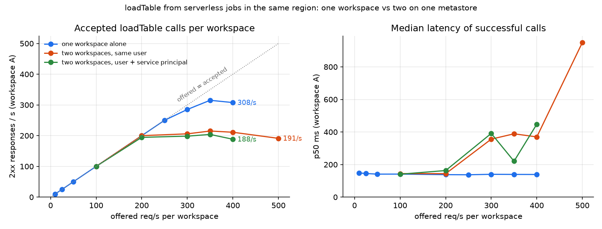
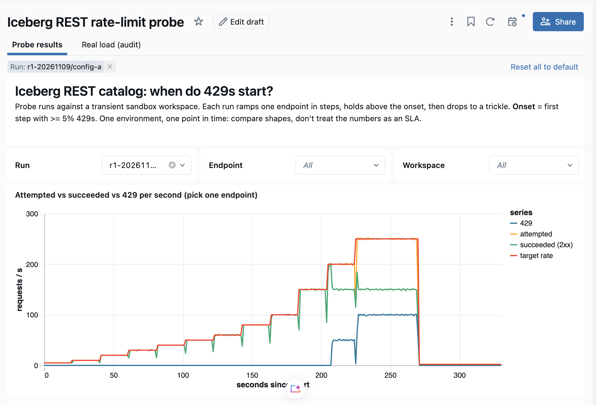

# 🚦 Iceberg REST catalog rate limits: where do 429s start?

**The question:** external engines (Spark, Trino, Snowflake, PyIceberg, …) that read Unity
Catalog tables through the Iceberg REST catalog (`/api/2.1/unity-catalog/iceberg-rest`) call
`loadTable` on every refresh. Fleets that refresh thousands of tables every few seconds
eventually see `429 Too Many Requests`. The circulating limit figures are unofficial and
contradict each other. This experiment **measures** them. It ramps each endpoint in steps,
holds above the limit, drops to a trickle, and logs every call.

All numbers come from [`results/summary.json`](results/summary.json) and
[`results/loadtable_scope.csv`](results/loadtable_scope.csv). They were measured on two freshly
provisioned, transient AWS serverless sandbox workspaces in one region, both attached to **one
shared metastore**, in 2026-11. Treat them as a snapshot of one environment, not an SLA.
Limits are server configuration and can change.

## Answers

| Question | Answer (measured) |
|---|---|
| **When do 429s start?** | `loadTable` **300/s** clean, 429s at 350/s · `config` **150/s** clean, 429s at 200/s · `loadTable` with `/credentials` **40/s** clean, 429s at 50/s · `listTables` never 429s to the client; past **~50/s** it queues instead (p50 117 ms → 8 s, client timeouts) · legacy `/iceberg` **5/s** clean, 429s at 8/s |
| **How long does throttling last?** | Only as long as the excess load. Accepted calls stay flat at the ceiling, and only the excess is rejected (a token bucket with about 1 s of burst). There is no penalty box: **0 s** of 429s after the load drops. |
| **Is `Retry-After` honoured?** | The per-workspace limiter sends `Retry-After: 1` on **100%** of its 429s, and waiting 1 s is enough. The shared limiter (below) sends **no `Retry-After`**, so clients need their own backoff. |
| **How long is recovery?** | **0-1 s** to the first clean second. Latency returned to baseline immediately from in-region compute. From a laptop, client queues took 12-58 s to drain. |
| **Per workspace, metastore or account?** | **Both layers.** Each workspace has its own budget: two workspaces each got the full 150/s `config`. A second limit is **shared across workspaces** on the same metastore, and it is not per principal: two workspaces pushing `loadTable` together got **~200/s each (~400/s combined)**, not 300/s each. The same happened when the second workspace called as a different identity. This setup cannot tell metastore scope from account scope, because both workspaces share both. |



### Two different 429s

The two limiters return different 429s. Your client and alerting should handle both.

| | Per-workspace limit (edge) | Shared limit (cross-workspace) |
|---|---|---|
| Body | `{"error_code":"RESOURCE_EXHAUSTED","message":"Too many requests. Please wait a moment…"}` | Iceberg-spec `{"error":{"type":"ServiceUnavailableException","code":429,"message":"Too many requests… [ErrorCode: 2001]"}}` |
| `Retry-After` | `1` (always) | absent |
| Comes with | flat latency; the excess is rejected cleanly | latency growth first (p50 140 ms → 350-970 ms), then a few % of 429s |
| In `system.access.audit` | **no** | yes (`uniformIcebergRestCatalog`, `status_code = 429`) |

The audit row matters: **a quiet audit log does not prove clients were never throttled.** The
per-workspace 429s never reach the service that writes audit rows.

### Compared with the circulating figures

| Figure that circulates | Measured here |
|---|---|
| `loadTable` 400-500/s per workspace | **~300/s** per workspace, plus a cross-workspace ceiling near 400/s combined |
| `/credentials` 40/s | ✅ 40/s |
| `listTables` 50/s | ✅ ~50/s, but it shows up as **latency, not 429s** |
| "Other routes" 40/s | ✗ `config` allowed 150/s |
| Legacy endpoint ~5/s | ✅ 5/s, and every call also returns `400 … Legacy Iceberg endpoints … are deprecated` |
| ~720/s total per workspace; 600/s or "6,000 CU/s" per metastore | Not isolated (see open questions). The shared ceiling seen here was ~400 `loadTable`/s on a metastore that other tenants also use. |

## Sizing worksheet

Estimate the steady-state call rate and compare it with the **lowest** measured limit in the
path:

```
loadTable/s ≈ Σ over engines ( tables_refreshed × readers ) / refresh_interval_s
config/s    ≈ client sessions started per second  (one per catalog init)
credentials/s ≈ loadTable/s that vend credentials, if the engine calls /credentials separately
```

| Scenario | Tables | Readers | Refresh | Expected loadTable/s | vs ~300/s per workspace | vs ~400/s shared |
|---|---:|---:|---:|---:|---|---|
| BI on a few marts | 200 | 2 | 60 s | 7 | ✅ | ✅ |
| Lakehouse federation | 2,000 | 3 | 60 s | 100 | ✅ | ✅ (one workspace) |
| Aggressive streaming reader | 2,000 | 2 | 10 s | 400 | ❌ 429s | ❌ |
| Many workspaces, one metastore | 1,000 per ws × 4 ws | 1 | 15 s | 67 per ws, 267 total | ✅ | ⚠️ near the ceiling |

Rules of thumb from the data:

- Budget for a **burst of about 1 s**. A refresh storm of N tables at once is N calls in one
  second. Spread refreshes, and add jitter if an engine refreshes everything on a timer.
- **Cache table metadata** client-side, and refresh on commit notifications or a longer
  interval. Most rate problems come from re-polling unchanged tables.
- Honour `Retry-After` when present. When it is absent (the shared-limit 429), use
  exponential backoff with jitter.
- Watch latency as well as 429s. The shared limit and `listTables` both degrade latency
  before, or instead of, failing.
- Move off the legacy `/iceberg` path. It is deprecated and limited to about 5/s.

## Method

- **Rig:** 50 managed Iceberg tables, 1 UniForm table, a volume and `EXTERNAL USE SCHEMA` per
  workspace (`make setup`). `make smoke` checks the PyIceberg config/list/load/scan path first.
- **Probe** (`scripts/01_probe.py`, aiohttp, open-loop):
  - Each step runs at a fixed target rate for 20 s, then holds for 45 s at 1.25× the last
    step, then recovers at 2/s for 30 s.
  - In-flight calls are capped at 250. A call that cannot get a slot is logged as
    **skipped**, never queued, so the client cannot hide a limit by slowing down.
  - Every call is logged: timestamp, endpoint, status, latency, `Retry-After`, 429 body and
    headers.
  - Hard caps: 1,000/s, 15 min and 250 in flight.
  - A live graph at `http://127.0.0.1:8765/` shows attempted, succeeded and 429 per second.
- **Endpoints:**
  - `config`
  - `listTables`
  - `loadTable`, in three modes: one hot table, round-robin over 50 tables, and without
    credential vending
  - `GET …/tables/{t}/credentials`
  - legacy `/iceberg/v1` `config` and `loadTable`
- **Where it runs matters.** From a laptop, a single workspace measured the same `loadTable`
  limit (300/s) as in-region serverless. Two workspaces at once (2× ~4 KB responses)
  saturated the downlink, so the scope tests run as a serverless job inside each workspace
  (`databricks/databricks.yml`, `make probe-job`). `scripts/06_run_in_workspace.py` starts
  the jobs at the same wall-clock instant. Raising concurrency did not help: at 800 in
  flight, the laptop's results got *worse*.
- **Scope test:**
  - Run 1: the same ramp in workspaces A and B simultaneously, as one user.
  - Run 2: the user in A and a service principal in B
    (`make probe-job WORKSPACES=a,b SP_SCOPE=b=<secret-scope>`; see
    [docs/method.md](docs/method.md)).
- **Analysis:** `make analyze` writes `results/` (scrubbed aggregates only; raw logs stay in
  the gitignored `data/`). `make plot` draws the scope chart.
- **Dashboard:** `make upload dashboard` loads the raw logs into a Delta table, creates the
  views in [`sql/views.sql`](sql/views.sql) (including `system.access.audit` views for
  `uniformIcebergRestCatalog`) and publishes an AI/BI dashboard.



## Caveats and open questions

- **One environment.** The metastore was shared with other tenants, whose load we could not
  see. The ~400/s shared ceiling may be "what was left" rather than a fixed number.
- **Metastore vs account** scope is unresolved. It needs a workspace on a second metastore
  in the same account (#111).
- **Per-workspace total across routes** (the ~720/s figure) was not tested. That needs a
  mixed-route ramp (#112).
- Each run was done once or twice. The repeated in-workspace `loadTable` run reproduced
  within 0.1 pp (10.0% vs 10.0% 429s at 350/s; 22.2% vs 23.1% at 400/s).

## Running it

```bash
make install && cp template.env dev.env    # point at transient sandbox workspaces ONLY
make auth-check setup smoke
make probe ENDPOINT=config                  # laptop run, live graph on :8765
make probe-all                              # laptop sweep of every endpoint
make job-deploy                             # serverless job in each workspace
make probe-job ENDPOINT=load_table_spread   # in-workspace, one workspace
make probe-job ENDPOINT=load_table_spread WORKSPACES=a,b   # scope test
make analyze plot upload dashboard
make cleanup                                # jobs, dashboard, schemas
```

**Run this only against workspaces you own and can throw away.** It deliberately drives the
catalog into 429s, and those 429s also hit anything else on the same workspace.

## Structure

The layout follows the house experiment shape:

- Makefile surface, uv-managed Python
- numbered scripts in `scripts/`
- pure analysis in `probe_core.py`, unit-tested against a mock catalog in `tests/`
- DAB-defined job, CLI-profile auth (no PATs)
- committed scrubbed results
